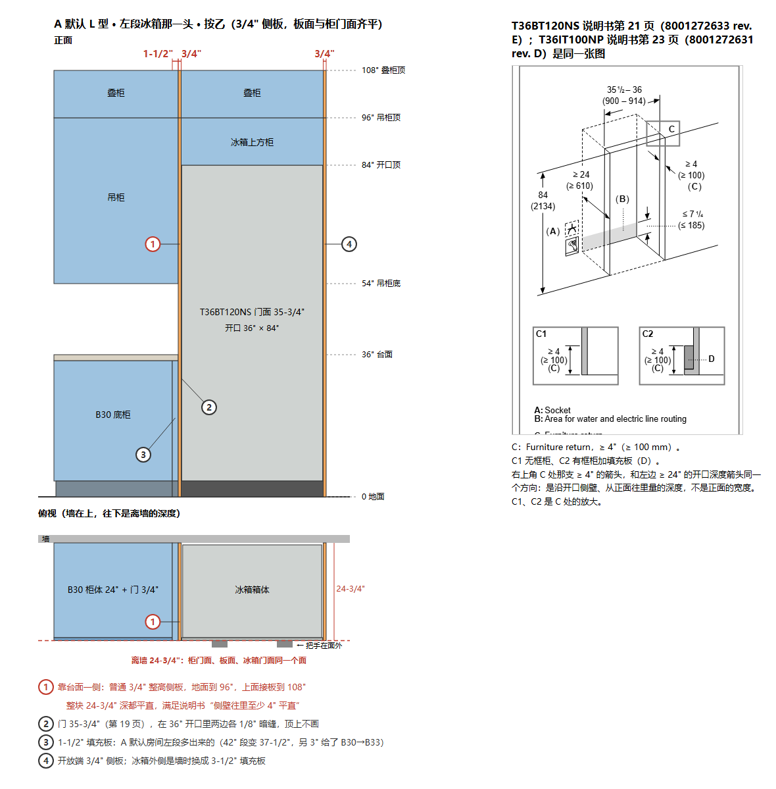

# 冰箱的正面 · 嵌入式冰箱直接贴柜子

> **计划定稿第二版（2026-10-27）**：按 Leo 2026-10-24 对 11 个问题的答复，和 2026-10-27 对第 6 节 7 个问题的答复（靠台面一侧选乙）重算。待 Leo 确认后动手，确认前不动代码。Leo 的决定以后写进 `docs/decisions.md`；做完之后以 `decisions.md` 为准，这份文件不再跟着改。

基准是填充板那一轮的提交 `7c043c1`。Leo 2026-10-24 的现场做法写在 `decisions.md` D11 rule 11 的 "Amended 2026-10-24" 一段，和 Open item "The two vertical strips beside A's refrigerator" 的 "Leo's answers (2026-10-24)"。

本文件里没注明出处的数字，都是在临时 git worktree（`7c043c1` 的拷贝）里，用仓库自己的代码和 `npx vite-node` 量的。"改后"的数字来自那个 worktree 里的**原型**，第 3.1 节写明原型包括什么、不包括什么。

这一版在仓库里改了三处：

- 这个文件；
- 新示意图 `docs/plans/fridge-front-side-panel.png`，换掉上一版的 4" 侧壁示意图；
- 新放进 `docs/reference/` 的 T36IT100NP 安装说明（第 2.2 节），`docs/reference/README.md` 加了一行。

---

## 0. Leo 的答复（照录）

### 0.1 2026-10-24，11 个问题

1. 「冰箱外侧：柜体」就是开放端，放 3/4" 侧板。
2. 靠台面那一侧：一块整高的柜体侧壁，正面 4" 宽，从地面到吊柜顶（有叠柜到 108"），对应说明书第 21 页的 4" 回边。（**已由 2026-10-27 第 1 条改为乙**，见下。）
3. A 默认 L 型冰箱旁边那块 2-1/4" 填充板：接受。
4. C 换嵌入式冰箱：甲，段不变，多出的补一块板。
5. A 换落地式 T36FT820NS：甲，换型号时段变长；墙不够时照 D18 自动加长并提示。
6. B 的柜组这一轮不动，放进第 101 轮。
7. 1/8" 画成暗缝；顶上不画（客人常把冷藏柱、冷冻柱放进一个连续的大柜子里）。
8. 门面齐平这一轮只用在嵌入式冰箱；柱子等第 101 轮读完说明书再定。
9. 「比开口深 1"，围合柜需加深」和「冰箱柜体」两处文字都留着。
10. 不锈钢反光不改：换成可装门板的版本后没问题了。**已从这一轮拿掉。**
11. 侧板和填充板的深度跟开口走（25"），高度跟旁边的高柜走（96"，有叠柜到 108"）。（深度已由 2026-10-27 第 2 条改为与柜门面齐平。）

### 0.2 2026-10-27，上一版第 6 节的 7 个问题

1. 4"：选乙。靠台面那一侧放一块普通 3/4" 整高侧板，满足说明书第 21 页"侧壁往里至少 4" 平直"的要求。不做正面 4" 宽的侧壁。按乙重算全部数字。
2. 板的深度：侧板和填充板的正面和柜门面齐平，不凸出；冰箱门面也在同一个面上。
3. A 默认 L 型冰箱旁的填充板：按乙重算后只要不超过 3" 就接受，超过就报给我。
4. C 一字型换嵌入式：按乙重算。放得下就照原答复（段不变、补板）；放不下再报给我。
5. A 一字型旧链接：按乙重算。放得下就没事；放不下就照 98b-2 对旧 E 链接的做法，照原样打开、不自动加长。
6. 换型号把墙加长时的提示：
   - 中文：「换了型号，{墙}不够长，已加长到 X″。」
   - 英文："The new model needs more room: {wall} is now X″."
   写进文字并锁进 reviewed.json。
7. 1/8"：画法选甲，门画成 35-3/4"（说明书第 19 页），两边自然各留 1/8"。去下载 T36IT100NP 的安装说明放进 docs/reference；有出处就两台都做，找不到就这一轮只做 T36BT120NS。

### 0.3 按乙重算后，每条答复的结果

| 答复（10-27） | 结果 |
|---|---|
| 3. 填充板不超过 3" | A 默认房间是 **1-1/2"**（`BF1.5`），不超过 3"，照答复接受。另外左段的一个 `B30` 变成 `B33`，见第 3.4 节。 |
| 4. C 一字型换嵌入式 | **放得下**。段保持 42-1/2"，补一块 2-1/4" 板，什么都不拿掉。照原答复做。 |
| 5. A 一字型旧链接（237.75"） | **放得下**。新的最短是 236"，旧链接照 237.75" 打开，什么都不拿掉，多出的 1-3/4" 成了冰箱旁一块填充板。 |
| 7. T36IT100NP 的出处 | **找到了**：Thermador 自己的 T36IT100NP 产品页把 BSH 的文件 8001272631 rev. D 列为它的安装说明。第 21 页门面 35-3/4"，第 23 页侧壁往里至少 4" 平直，和 T36BT120NS 的说明书同一张图。所以**两台都做**。 |

重算时又冒出两件事，答复里没有覆盖到，列在第 6 节。

---

## 1. 现状（`7c043c1`）

### 1.1 段宽：A 的冰箱段 `T4296`，42" = 3" + 36" + 3"

- **开口宽**：`openingIn`（`src/data/layoutTemplate.ts:617-618`）= 机器宽 + 有 `enclosure` 时两边各 `PANEL_IN`。
- **3" 从哪来**：`PANEL_IN = 3`（`src/data/roomShell.ts`）。没有任何文件给出这个 3"，从第一个场景提交 `ae79efe` 就在。
- **段**：`fridgeSegmentIn`（`layoutTemplate.ts:629-633`）。嵌入式直接返回 `openingIn`，不看冰箱外侧是柜体还是墙。所以 A 靠墙时也是 42"：墙边是 3" 侧板，没有 3-1/2" 填充板。
- **模块**：`single` 的嵌入式分支（`layoutTemplate.ts:1782-1799`）只放一个 `T4296` 模块。段比它宽时再加一块 `PNL` 补边，就是 C 一字型换嵌入式时的 1/2"。
- **画法**：`cabinets.ts:347-358`。`tall` 模块没有 `insetIn` 时用 `PANEL`（3"）当内缩，两边各画一块 `surround`（`-panel-a`、`-panel-b`）：24" 的柜体加 3/4" 板面，落地到 96"，叠柜处到 108"，`face: "strip"`。这就是 Leo 看到的两条竖条。中间开口上面是 `-bridge`。
- **开口位置**：`fridgeOpeningOf`（`layoutTemplate.ts:3624`）用 `insetOf`（`:621`，有 `enclosure` 就是 3"）从段两头往里缩。`fridgeAt`（`:2902`）把机器放在 `tall` 模块的正中。
- **踢脚板**：`endOnTheFloor`（`cabinets.ts:717`）。冰箱段结尾时，踢脚板停在 3" 板的里面。

### 1.2 尽头的填充板和侧板

- **3-1/2"**：`LAYOUT_LIMITS.fridge.fromWallIn = 3.5`。今天只有独立式（C 自己的 T36FT820NS）和柱组靠墙时才放。
- **3/4"**：今天冰箱旁没有 3/4" 板。3/4" 是柱组和烤箱塔的板（`LAYOUT_LIMITS.towerSpacer.panelIn`）。
- **清单那一行**：`fridgeDoorClearance`（`useChecklist.ts`）和尺寸 `fridge-door-clearance`（`dimensions.ts`）都去找冰箱段里的 `filler`。所以段里一有 `BF3.5`，就自动出现「冰箱与墙之间需 3.5" 整高挡板…」和那条尺寸。

### 1.3 1/8"：今天画的是 0

- 机器宽取 `widthIn`（`applianceBox.ts`），T36BT120NS 在目录里是 36"。门板由 `fridgeParts` 铺满整个 36"。
- `FRIDGE_PROPORTIONS.gapIn = 0.125`（`fridgeModel.ts:85`）只用在门和门之间、门和抽屉之间，不用在门和两边之间。门和 3" 板之间是 0"。
- 手册第 19 页：箱体 35-1/4"，**门面 35-3/4"**；第 20 页：开口 35-1/2"–36"。36" 开口里放 35-3/4" 的门，正好每边 1/8"。

### 1.4 门面比柜门面靠后 1"

- 机器盒子深：T36BT120NS 没有 `depthIn`，取 `cutoutDepthIn` 25"。盒子背靠墙（`flushOffset`，`applianceBox.ts:164`）。
- 嵌入式分支（`fridgeStance`，`fridgeModel.ts:144`）把把手算在 25" 里面，门面离 run 中线 **11-3/4"**。
- 柜门面 = 半个柜深 12" + 门厚 3/4" = **12-3/4"**。所以只有把手伸到柜门面前面。
- 清单里另有一行「比开口深 1"，围合柜需加深」（`rule.deeperThanOpening`，以 24" 柜深为基准）。A 默认房间的冰箱一直有这一行。第 9 条：留着。

---

## 2. 改法

### 2.1 段宽和尽头（`layoutTemplate.ts`、`cabinets.ts`）

**单台嵌入式的段 = 靠台面一侧 3/4" 侧板 + 机器宽 + 尽头一块。**

- 尽头是柜体（开放端）时：3/4" 侧板（`PNL0.75`，`panel`）。
- 尽头是墙时：3-1/2" 填充板（`BF3.5`，`filler`）。和独立式靠墙时用同一个词「靠墙填充板」。

| | 靠台面 | 机器 | 尽头 | 段 | 今天 |
|---|---|---|---|---|---|
| 外侧柜体（开放端） | 3/4" 侧板 | 36" | 3/4" 侧板 | **37-1/2"** | 42" |
| 外侧墙身 | 3/4" 侧板 | 36" | 3-1/2" 填充板 | **40-1/4"** | 42" |

- **模块**：`[PNL0.75, T3696, PNL0.75]` 或 `[PNL0.75, T3696, BF3.5]`。`T3696` 带 `insetIn: 0`，`cabinets.ts` 就不画两块 3" 板。一字型由 `fromTheWall` 自动倒过来，变成 `BF3.5 T3696 PNL0.75`。
- **示意图**（`docs/plans/fridge-front-side-panel.png`）：A 默认 L 型左段冰箱那一头。
  - 上半是正面：靠台面一侧的 3/4" 侧板从地面到 96"，上面接板到 108"。
  - 下半是俯视：柜门面、板面、冰箱门面都在离墙 24-3/4"。
  - 右边是说明书第 21 页。

  

- **板的深度和高度**：
  - 深度（10-27 第 2 条）：侧板和填充板的正面在离墙 24-3/4"，与柜门面齐平。这就是今天 3" 板的画法（24" 柜体加 3/4" 板面），不凸出。
  - 高度（10-24 第 11 条）：跟旁边的高柜走，96"；有叠柜时走已有的 `stackOn`，接一块板到 108"，冠线照旧。
- **画法**：板都走 `cabinets.ts` 已有的「panel / tall 段里的 filler」分支（`:298-313`），落地。`endOnTheFloor` 改成读最后一块板的宽（0.75 或 3.5），不再假设 3"。
- **开口位置**：`fridgeOpeningOf` 对单台嵌入式取 `tall` 模块自己的范围，不再用 `insetOf` 往里缩。柜组照旧，保证 B、D、E 一个字节不变。
- **`openingIn`、`PANEL_IN` 不删**：B 的柜组（`bank()`）、独立式规则 11 和别处还用。
- **C 换嵌入式**（10-24 第 4 条、10-27 第 4 条）：段保持 C 自己的段，多出的放在靠台面一侧，一块单独的 `PNL`，在 3/4" 侧板外面：
  - L 型，外侧柜体：42" = `PNL4.5 PNL0.75 T3696 PNL0.75`；
  - L 型，外侧墙身：42-1/2" = `PNL2.25 PNL0.75 T3696 BF3.5`；
  - 一字型（外侧是墙）：42-1/2" = `BF3.5 T3696 PNL0.75 PNL2.25`。
  - 三种都放得下，什么都不拿掉。
- **A 换 T36FT820NS**（10-24 第 5 条）：段取 A 自己的段和规则 11 要的（3" + 36" + 墙边 3-1/2" 或柜边 3"）两者中较大的：
  - 外侧柜体：37-1/2" → **42"**，`PNL3 RO36 PNL3`，和今天一样；
  - 外侧墙身：40-1/4" → **42-1/2"**，`PNL3 RO36 BF3.5`（今天 42"，`PNL2.5 RO36 BF3.5`）。

### 2.2 1/8"（`applianceBox.ts`、`fridgeModel.ts`、`ApplianceModel.tsx`）

- 10-27 第 7 条，甲：门画成 **35-3/4"**，在 36" 开口里居中，两边自然各留 1/8"，缝里是暗色。顶上不画（10-24 第 7 条）。段宽不受影响。
- 门宽的出处：
  - T36BT120NS：说明书 8001272633 rev. E 第 19 页；
  - T36IT100NP：说明书 8001272631 rev. D 第 21 页。
  - 两台都是箱体 35-1/4"、门面 35-3/4"。
  - 门宽写进目录的一个新字段，或写进画法，动手时看哪种改得少；两台都要有出处。
- **T36IT100NP 的出处**：BSH 服务器上的 `8001272631_D.pdf`。
  - Thermador 自己的 T36IT100NP 产品页把它列为 installation instruction。文件本身没有印型号。
  - 84 页，13,276,502 字节，2026-10-27 下载。
  - 放在 `docs/reference/t36it100np-install.pdf`，README 加了一行。
  - 第 23 页和 T36BT 说明书第 21 页是同一张图：侧壁往里至少 4" 平直，C1 无框柜、C2 有框柜加填充板。
  - 它的规格表（目录的 `sourceUrl`）写：在 25" 深的柜子里、门板 3/4" 时完全齐平。
- 用在哪里：**单台嵌入式**，即 A 的冰箱段和 C 换进来的嵌入式，T36BT120NS 和 T36IT100NP 两台都做。
  - B 的柜组这一轮不动（10-24 第 6 条），B 的 T36BT120NS 不加。
  - 柱子（T30IR905SP、T24IR905SP）不加（10-24 第 8 条）。

### 2.3 门面齐平（`fridgeModel.ts` 的 `fridgeStance` 嵌入式分支、`applianceBox.ts` 的 `flushOffset`）

- 冰箱门面放在柜门面上：离墙 24-3/4"，也就是 run 中线外 12-3/4"，和两边的板同一个面（10-27 第 2 条）。把手在门面外面；今天是"把手算在 25" 里面"。
- 两台都做（10-27 第 7 条）。柱子等第 101 轮（10-24 第 8 条）。

### 2.4 换型号时段变长、墙加长（10-24 第 5 条、10-27 第 6 条；`layoutState.ts` 的 `setFridgeModel`）

- **墙**：`setFridgeModel` 今天用 `setLayoutParams`，墙不够就拒绝。原型上量到 L 型有两种房间会被拒（A，冰箱在后段、盲角、无岛台）：

  | 冰箱外侧 | 后墙（新下限） | 换 T36FT820NS 要 | 差 |
  |---|---|---|---|
  | 柜体 | 124.5" | 129" | 4.5" |
  | 墙身 | 127.25" | 129.5" | 2.25" |

  改成照 D18 加长，用 `setLayoutParamsGrowing`，弹提示，可以撤销。
- **提示**：10-27 第 6 条的两句，新加一个键，`approval: "written"` 锁进 `src/i18n/reviewed.json`：
  - 中文：`换了型号，{wall}不够长，已加长到 {toIn}。`
  - 英文：`The new model needs more room: {wall} is now {toIn}.`
  - `{toIn}` 用已有的 `inchesSpoken`，它自己带 ″，就是 Leo 句子里的 X″。`{wall}` 用已有的「后墙 / 左墙」词。
- **一字型**：一字型墙不够时今天的规矩是拿掉多出的柜位（round 98b），不加长。A 一字型换 T36FT820NS 正好碰到这一条，见第 6 节问题 1。

### 2.5 文字

- 10-24 第 9 条：「比开口深 1"，围合柜需加深」和「冰箱柜体」都留着，不改。
- `BF3.5` 用已有的「靠墙填充板」；`PNL0.75` 在墙的账单上走已有的板的词（`machineLabel.test.ts` 会查每个词都有）。
- 新提示一句，见第 2.4 节。

---

## 3. 会变的房间（按乙）

### 3.1 原型包括什么

在临时 worktree 里只改了 `layoutTemplate.ts`：

1. `fridgeSegmentIn` 和 `single` 嵌入式分支照第 2.1 节，靠台面一侧 3/4"；
2. `fridgeOpeningOf` 照第 2.1 节；
3. C 换嵌入式时段保持，多出的补一块 `PNL`；
4. A 换 T36FT820NS 时段取两者中较大的。

**不包括**：

- 1/8"、门面齐平；
- 换型号时加长墙（第 2.4 节）；
- 新提示的文字。

dump 记的是柜体和段，1/8" 和齐平本来就不在 dump 里，只在像素里。换型号加长墙会让第 2.4 节那两种房间从"被拒"变成"加长"，它们不在 dump 的房间名单里（dump 只在每个套餐自己的房间里换型号）。

### 3.2 总数

| | 房间 | 变了 | 不变（逐字节） | 建成 / 拒绝，改前 → 改后 |
|---|---|---|---|---|
| L 型（`scripts/lDump.ts`） | 1,045 | **118** | 927 | 515 / 530 → 515 / 530 |
| 一字型（`scripts/oneWallDump.ts`） | 91 | **24** | 67 | 91 / 0 → 91 / 0 |

变了的房间和上一版（4" 侧壁）是同一批，只是数字不同。

**L 型变了的 118 个**：

- A 的排法 99 个：A 建成的全部 99 个，包括 `A {}`、`A {"housingStyle":"sweep"}` 和 `A {"backWallIn":214.375,"leftWallIn":171.125}`。
- A 的换型号 15 个：
  - `A swap slot-fridge=` T24IR905SP、T30IR905SP、T36IT100NP；
  - `slot-range=` MFGS4030RS、PCG366W、HIS8055U、PRG304WH；
  - `slot-hood=` JVM3160RFSS、AK7136BS-BF、AK7300AS、VCIN36GWS、HMWB361WS、HMCB30WS、HMCB36WS；
  - `slot-dishwasher=SHX78CM5N`。
- C 的换型号 4 个：`C swap slot-fridge=` T24IR905SP、T30IR905SP、T36IT100NP、T36BT120NS。

**L 型不变的**：

- `A swap slot-fridge=T36FT820NS`：段长回 42"，与今天同为 `PNL3 RO36 PNL3`。
- A 被拒的 96 个：前后一字不差。
- B、D、E 的全部房间，C 自己的排法。

**一字型变了的 24 个**：

- A 的全部 20 个：4 个排法（`{}`、sweep、`{"backWallIn":246}`、`{"backWallIn":276}`）和 16 个换型号，**包括 T36FT820NS**。
- C 的 4 个：`C one-wall swap slot-fridge=` T24IR905SP、T30IR905SP、T36IT100NP、T36BT120NS。
- B、D、E 的一字型全部不变。

**哪些字段变了**：

- L 型 118 个：
  - 全变：`runs`、`fridgeOpening`、`placement`、`cabinets`、`labelled`、`perSlot`、`requirement`；
  - `outlines` 和 `counter` 114 个，`points` 111 个，`dimensions` 72 个；
  - 墙的账单（`words`）46 个：腿上的账单多出板的那几行；
  - 冰箱在后段（和灶同一条腿）、外侧柜体的 24 个，油烟机开口跟着移（`hoodOpening`、`hoodOutlet`）。
- L 型里冰箱外侧是墙的 48 个：`wallClearance` 和清单变，清单多了 `fridge-door-clearance`。今天 A 靠墙只有 3" 板，没有 3-1/2" 的门间隙；改后有了。
- 一字型 24 个：
  - 23 个多了 `fridge-door-clearance`（A 一字型的冰箱外侧固定是墙；换 T36FT820NS 的那个今天就有）；
  - A 的 18 个默认墙变了（237.75" → 236"，第 3.5 节）；
  - `A one-wall swap slot-fridge=T36FT820NS` 拿掉了微波抽屉和酒柜，见第 6 节问题 1。

### 3.3 A，L 型，每种排法的墙最短（英寸，改前 → 改后）

「最短」是 `wallRequirement(...).minimumIn`，「滑杆下限」是 `feasibleRange(...).minIn`。

- A 没有烤箱塔和咖啡柜，`towerSide`、`coffeeLeg` 不影响 A，所以每一行是 4 个房间。
- 冰箱在左段时水槽在后段，冰箱在后段时水槽在左段。另外两种组合 A 本来就拒绝，前后一样。

| 冰箱段 | 转角 | 冰箱外侧 | 岛台 | 后墙最短 | 左墙最短 | 后墙滑杆下限 | 左墙滑杆下限 |
|---|---|---|---|---|---|---|---|
| 左段 | 盲角 | 柜体 / 墙身 | 平行 | 147 不变 | 105 不变 | 147 不变 | 105 不变 |
| 左段 | 盲角 | 柜体 / 墙身 | 垂直 | 147 不变 | 105 不变 | 147 不变 | 141 不变 |
| 左段 | 盲角 | 柜体 | 无 | 147 不变 | **99 → 96** | 147 不变 | **99 → 96** |
| 左段 | 盲角 | 墙身 | 无 | 147 不变 | **99 → 97.25** | 147 不变 | **99 → 98** |
| 左段 | 转盘 | 柜体 / 墙身 | 平行 | 159 不变 | 105 不变 | 159 不变 | 105 不变 |
| 左段 | 转盘 | 柜体 / 墙身 | 垂直 | 159 不变 | 105 不变 | 159 不变 | 141 不变 |
| 左段 | 转盘 | 柜体 / 墙身 | 无 | 159 不变 | 96 不变 | 159 不变 | 96 不变 |
| 后段 | 盲角 | 柜体 / 墙身 | 平行 | 141 不变 | 126 不变 | 141 不变 | 126 不变 |
| 后段 | 盲角 | 柜体 / 墙身 | 垂直 | 141 不变 | 126 不变 | 141 不变 | 141 不变 |
| 后段 | 盲角 | 柜体 | 无 | **129 → 124.5** | 126 不变 | **129 → 125** | 126 不变 |
| 后段 | 盲角 | 墙身 | 无 | **129 → 127.25** | 126 不变 | **129 → 128** | 126 不变 |
| 后段 | 转盘 | 柜体 / 墙身 | 平行 | 141 不变 | 120 不变 | 141 不变 | 120 不变 |
| 后段 | 转盘 | 柜体 / 墙身 | 垂直 | 141 不变 | 120 不变 | 141 不变 | 141 不变 |
| 后段 | 转盘 | 柜体 | 无 | **141 → 136.5** | 120 不变 | **141 → 137** | 120 不变 |
| 后段 | 转盘 | 墙身 | 无 | **141 → 139.25** | 120 不变 | **141 → 140** | 120 不变 |

- 外侧柜体的段短 4-1/2"（42" → 37-1/2"），外侧墙身的段短 1-3/4"（42" → 40-1/4"）。
- **没有一行会升**。上一版（4" 侧壁）升的 5 行，按乙全不升。所以 L 型的旧链接都照原墙长打开，不会加长。
- 有岛台时，冰箱那条腿的下限由岛台定，段变短也不动。
- 墙在新、旧下限之间的房间（例如后段、盲角、无岛台、外侧柜体，后墙 124.5"–129"）今天打不开，改后能打开。这样的房间里换回 T36FT820NS 就要加长墙，见第 2.4 节。

### 3.4 A 的默认房间（L 型，168 × 144）

- 墙不变：下限 147 / 105，`feasibleRange` 147 / 105，全不变。默认的冰箱外侧是柜体（开放端）。
- 左段（从转角往外）：

  | | 左段 | 段宽 |
  |---|---|---|
  | 今天 | `BBC42` · `B30` · `B30` · `T4296` | 42 · 30 · 30 · 42 |
  | 改后 | `BBC42` · `B33` · `B30` + `BF1.5` · `PNL0.75` `T3696` `PNL0.75` | 42 · 33 · 31.5 · 37.5 |

- **冰箱段短了 4-1/2"**：3" 给了第一个底柜（`B30` → `B33`），1-1/2" 成了一块填充板，在第二个 `B30` 和 3/4" 侧板之间。1-1/2" 不超过 3"，照 10-27 第 3 条接受。
- 后段不变：`DB21 RO36 B30 SB30 RO24 BF3`。
- sweep 罩柜和 214.375 × 171.125 两个房间同样只变左段。14 个换型号的房间（换成柱子、换灶、换油烟机、换洗碗机）也一样，冰箱段都是 `PNL0.75 T3696 PNL0.75`。

### 3.5 A 的一字型，和 C

| 房间 | 最短 | 滑杆下限 | 打开时的墙 | 冰箱段 | 拿掉的 |
|---|---|---|---|---|---|
| `A one-wall {}`、sweep、换灶 / 换油烟机（除 JVM3160RFSS）/ 换洗碗机 / 换柱子 | **237.75 → 236** | **177 → 176** | **237.75 → 236** | `T4296` → `BF3.5 T3696 PNL0.75`（40.25） | — |
| `A one-wall swap slot-hood=JVM3160RFSS` | **213 → 211.25** | **177 → 176** | **237.75 → 236** | 同上 | 微波抽屉，前后一样 |
| `A one-wall {"backWallIn":246}`、`{"backWallIn":276}` | 237.75 → 236 | 177 → 176 | 246 / 276 不变 | 同上 | — |
| `A one-wall swap slot-fridge=T36FT820NS` | 237.75 → 177.5 | **177 → 178** | **237.75 → 236** | `BF3.5 RO36 PNL2.5`（42）→ `BF3.5 RO36 PNL3`（42.5） | **微波抽屉和酒柜**（今天不拿），第 6 节问题 1 |
| `C swap slot-fridge=` 四个（L 型） | 141 / 105 不变 | 不变 | 168 × 144 | `T4296` → `PNL4.5 PNL0.75 T3696 PNL0.75`（42） | — |
| `C one-wall swap slot-fridge=` 四个 | 232.25 不变 | 172 不变 | 232.25 不变 | `PNL0.5 T4296` → `BF3.5 T3696 PNL0.75 PNL2.25`（42.5） | — |

- **A 的一字型**：冰箱外侧固定是墙，段从 42" 变 40-1/4"。所以默认墙和下限都减 1-3/4"（`oneWallWantedIn` 237.75 → 236）。一字型滑杆上限 `ONE_WALL_MAX_IN = 276` 由 E 定，不变。
- **A 一字型的旧链接**（墙 237.75"，10-27 第 5 条）：原型上照 237.75" 打开，什么都不拿掉，墙不变。多出的 1-3/4" 成了冰箱旁 `B15` 后面一块 `BF1.75`。
- **C**：
  - 换嵌入式，两种形状都放得下，段不变，什么都不拿掉（10-27 第 4 条）；
  - C 自己的冰箱（T36FT820NS，独立式）两种形状都不变。
- **A 的 L 型换 T36FT820NS，冰箱外侧是墙**（这种房间不在 dump 的名单里）：段 42" → 42-1/2"，`PNL2.5 RO36 BF3.5` → `PNL3 RO36 BF3.5`。默认墙长下，旁边的 `B30` 变成 `B27` + `BF2.5`，墙不用加长。

### 3.6 分享链接

- 链接里写着 `back=` / `left=`，打开时按链接的墙建房（`openLink.ts`，`setLayoutParamsGrowing`）。
- **L 型**：没有一行下限会升，旧链接都照原墙长打开，只是房间不同。
- **一字型**：A 的旧链接放得下（第 3.5 节）。
- `scripts/pixelLinks.json` 里会变的两条：
  - A 链接（T36IT100NP，177.375 × 151.125，冰箱在左段、外侧墙身、有岛台）的房间会变；
  - C 链接（T36BT120NS，外侧墙身）的柜体和段会变。原型上 3D 画面 0 像素差，因为 `PNL2.25 PNL0.75` 和 `BF3.5` 的宽正好等于今天的 3" 板和 3" + 1/2" 板；屏幕上多了门间隙那条尺寸。见第 5 节。
  - B、D、E 的不变。
- `src/store/shareLinkV2.test.ts` 和 `shareLinkRound98b1.test.ts` 里 A、C 的房间哈希会变：这是 Leo 这次要的改变，按新房间更新哈希，写明原因。

---

## 4. 测试怎么先红后绿

**先写，在 `7c043c1` 上读出红的原因，再改代码。** 按记忆里的"非对称样本"，挑两边不等的：冰箱外侧墙身（3/4" 和 3-1/2"），和一字型倒过来的 `BF3.5 T3696 PNL0.75`，不只挑开放端。

1. **`src/data/fridgeSwap.test.ts`**（第 89 轮的表，手写）：
   - A 的四个嵌入式 / 柱子改成 `PNL0.75 T3696 PNL0.75 (37.5)`；
   - A 外侧墙身的改成 `PNL0.75 T3696 BF3.5 (40.25)`；
   - C 的四个：`PNL4.5 PNL0.75 T3696 PNL0.75 (42)`；外侧墙身 `PNL2.25 PNL0.75 T3696 BF3.5 (42.5)`；
   - A 换 T36FT820NS：外侧柜体 `PNL3 RO36 PNL3 (42)`，外侧墙身 `PNL3 RO36 BF3.5 (42.5)`；
   - 旧代码上是 `T4296 (42)` 或 `PNL2.5 RO36 BF3.5 (42)`，红。
2. **新单元测试 `src/data/fridgeFront.test.ts`**，旧代码全红：
   - A 和 C 每种冰箱位置 × 外侧 × 形状，冰箱段的模块和宽度；
   - 冰箱段里没有 `-panel-a/-panel-b`；
   - 3/4" 侧板、3/4" 尽头侧板、3-1/2" 填充板各自的宽、高（96"，叠柜到 108"）、正面离墙 24-3/4"；
   - 清单 `fridge-door-clearance` 出现在 A 外侧墙身的房间里；
   - 墙最短照第 3.3 节的表手写，挑不对称的几行：后段、盲角、无岛台，外侧柜体后墙 124.5、外侧墙身 127.25；左段、盲角、无岛台，左墙 96 和 97.25；
   - A 默认房间左段 `BBC42 B33 B30 BF1.5 PNL0.75 T3696 PNL0.75`；
   - A 一字型默认墙 236，237.75 的旧墙照原样打开、什么都不拿掉；
   - C 一字型换 T36BT120NS 是 `BF3.5 T3696 PNL0.75 PNL2.25`、什么都不拿掉。
3. **换型号加长墙**（第 2.4 节）：A 冰箱在后段、盲角、外侧柜体、无岛台、后墙 124.5"，换 T36FT820NS：墙加长到 129"，`grown` 记一条；外侧墙身 127.25" → 129.5"。
   - 旧代码在这里不会被拒（旧下限 129，墙打开时已经加长到 129），所以这一条要在新段上才能写出来。
   - 红绿怎么证明：先只改段、不改 `setFridgeModel`，读出"被拒，差 4.5" / 2.25""；再改 `setFridgeModel`，变绿。两次都写进报告。
   - 提示的两句由 `reviewed.test.ts` 锁住：先把两句写进 `reviewed.json`，在没有这个键的旧代码上红。
4. **1/8"**（`fridgeModel.test.ts` / `applianceBox.test.ts`）：
   - T36BT120NS 和 T36IT100NP 单台嵌入式时，门 35-3/4"，门和开口两边之间各 1/8"，顶上 0；
   - B 柜组里的 T36BT120NS 仍是 0；柱子仍是 0；
   - 旧代码上两边是 0，红。
5. **门面齐平**（`fridgeModel.test.ts` 已有 "leaves a built-in exactly as it was" 一条，按答复改写）：
   - 两台的门面都在 run 中线外 12-3/4"，与柜门面、两边的板同一平面，把手在外；
   - 旧代码 T36BT120NS 是 11-3/4"，红。
6. **浏览器测试** `tests/fridgeSurround.test.ts` 加 A 的几条，照 `tests/sideStrips.test.ts` 用 three.js devtools 钩子读场景：
   - 鼠标在电脑上、手指在手机上（记忆：脚本点击和真实输入可能不一样，两样都要）；
   - 量冰箱两边：3/4" 侧板和 3/4" 侧板（或 3-1/2" 填充板）的宽；门边到它们的缝；门面和柜门面、板面的前后差；
   - 换 T36FT820NS 时墙加长的提示出现、文字对、能撤销；
   - 在 `7c043c1` 的构建上红。

**原型上跑过的现有单元测试**（按乙，只改段）：3,007 条里 **19 条红，9 个文件**，和上一版同一批，原因按乙重读过。每一条都要按新规则改写，写明原因：

- `fridgeSwap.test.ts` 4 条：
  - 第 89 轮那张表：上面第 1 项；
  - "builds package C's own refrigerator opening into an enclosure for the built-in T36BT120NS"：`T4296` → `PNL4.5 PNL0.75 T3696 PNL0.75`；
  - "keeps the 3-1/2 inches against a return wall in A's segment"：`PNL2.5 RO36 BF3.5`（42）→ `PNL3 RO36 BF3.5`（42.5），沿腿的东西挪了；
  - "gives a built-in in C's segment … a half-inch scribe"：`T4296 PNL0.5` → `PNL2.25 PNL0.75 T3696 BF3.5`。
- `layout.test.ts` 4 条：
  - 「sizes each opening to what goes in it」：42 → 37.5；
  - 「runs the tower to a standard height at base depth」：找不到 `left-fridge-panel-a`；
  - 「sizes every run segment in 3 inch increments」：`left-corner-landing-1` 多了 `BF1.5`；
  - 「runs the toe kick … to the end」：0.75 对 3。
- `layoutTemplate.test.ts`「gives every cabinet a trade code」：默认房间里出现 `BF1.5`、`PNL0.75`，不合 `/^[A-Z]{1,4}\d{0,4}$/`。别处的房间早就有 `BF3.5`、`PNL0.75`，只是这条测试只看默认房间。改成允许一位小数。
- `layoutState.test.ts`「re-cuts the carcass around the appliances that moved」：找冰箱的 3" 板盒子。
- `oneWall.test.ts` 2 条：A 的墙 237.75 → 236；墙边从 `T4296` 变 `BF3.5`。
- `spareDivider.test.ts` 1 条：A 那条腿的账单 159.75 → 155.25。
- `toeKick.test.ts` 2 条：A 的板的名字（`-panel-a/b` → `PNL0.75`），踢脚停在 3" 还是 0.75"。
- `src/store/shareLinkV2.test.ts` A、C 两条，`src/store/shareLinkRound98b1.test.ts` A L、A one-wall 两条：链接打开的房间变了。这是 Leo 这次要的改变，按新房间更新哈希，写明为什么。

---

## 5. 证明哪些不变

- **几何**：`scripts/lDump.ts` 和 `scripts/oneWallDump.ts`，`7c043c1` 对新树。
  - L 型 1,045 个里不在第 3.2 节名单上的 **927 个**逐字节相同；一字型 91 个里的 **67 个**逐字节相同。
  - 名单上的 118 + 24 个逐个看差在哪里：只能差在冰箱段、它那条腿上的台面和柜子，和由此来的尺寸、清单、账单、墙长、油烟机开口。
  - 1/8"、齐平不进 dump，只在像素里。
- **像素**：`scripts/pixelShots.mjs`，`?qualityLock=1`，高低两档，45 个状态，旧新各拍两次交替，`scripts/pixelCompare.mjs` 比，差别图给 Leo 看。
  - **应该变的 11 个**：
    - 原型（按乙，只改段）上高档旧新各拍一次，3D 画面差的像素数：
      - `desk-A-materials` 11,631、`desk-A-white` 10,675、`desk-A-install` 40,834、`desk-A-fly-refrigerator` 229,484、`desk-A-fly-dishwasher` 2,614；
      - `link-A` 5,372、`link-A-noisland` 5,372（T36IT100NP，外侧墙身）；
      - `phone390-A` 2,326、`phone360-zh-A` 1,904。
    - `link-C`、`link-C-noisland`（T36BT120NS，外侧墙身）：原型上 3D 画面 0 像素（第 3.6 节），屏幕上多出门间隙那条尺寸。加上 1/8" 和门面齐平以后，3D 画面也会变。
  - 其余 34 个 3D 画面在原型上 0 像素。
    - 屏幕上每个状态都差两处文字，都是构建印的提交号，不是这一轮的。旧的构建是 `c89fd26` 印的，原型是 `7c043c1`。正式比的时候两边都在提交后构建，这一处就没有了。
    - 1/8" 和齐平只加在 A 和 C 的单台嵌入式上，不会多出别的状态。
    - 其余应该 0 像素，除了已知的那个噪点 (144, 225)。
- **预览**：
  - 单独截 3/4" 侧板那一处给 Leo 确认（10-24 第 2 条要的单独截图，按乙）；
  - A 默认房间冰箱两边改前改后，电脑和手机各一张；
  - 换 T36FT820NS 加长墙的提示，中英文各一张。
- **全套测试**：单元测试、浏览器测试、构建全过；第 4 节那些红的每条写明改的原因。电脑保持不睡。
- **上线**：提交之后，带计数器地址构建，和线上逐个文件比对。

---

## 6. 动手前还要 Leo 定的

这两条是按乙重算时冒出来的，答复里没有覆盖到，列出来不选。

1. **A 一字型换 T36FT820NS**：
   - 按乙，A 一字型的默认墙是 236"（今天 237.75"）。
   - 换成 T36FT820NS，段从 40-1/4" 变 42-1/2"（10-24 第 5 条，取两者中较大的），多 2-1/4"。
   - 原型上墙不变，**微波抽屉和酒柜被拿掉**（一字型墙不够时的老规矩，round 98b）。今天在 237.75" 换这台，什么都不拿掉。
   - 要什么都不拿掉，墙要 238.25"（量过：238.125" 还会拿掉）。
   - 两种做法：
     - 甲：照 10-24 第 5 条，换型号时一字型也加长墙，236" → 238.25"，弹 10-27 第 6 条那句提示，可以撤销；
     - 乙：照一字型的老规矩，墙不变，拿掉两个柜位，提示照旧。
   - L 型没有这个问题：L 型墙不够时本来就加长（第 2.4 节）。
2. **T36IT100NP 的开口深度，目录和说明书不一样**：
   - 目录（`data/appliances.json`）写的是 `depthIn` 24、`cutoutDepthIn` 24。
   - 说明书第 22、23 页写开口至少 25" 深。目录自己的出处（规格表 25549011）写 `84" x 36" x 25"`，并写 25" 深的柜子、3/4" 门板时完全齐平。
   - T36BT120NS 在目录里是 `cutoutDepthIn` 25。所以今天 A 的冰箱有「比开口深 1"，围合柜需加深」这一行，换成 T36IT100NP 时没有。
   - 门面齐平（第 2.3 节）不靠这个数，两台都放在 24-3/4"。
   - 两种做法：
     - 甲：这一轮把 T36IT100NP 的 `cutoutDepthIn` 改成 25。这样它也有「比开口深 1"…」那一行，A 链接（`link-A`）和换成它的房间清单会多一行，`fit.ts` 的深度检查也跟着这个数走。动手前要按这个再量一遍，第 3、5 节的名单可能变长。
     - 乙：这一轮不改目录，记一条 Open item，以后和别的目录数字一起查。
