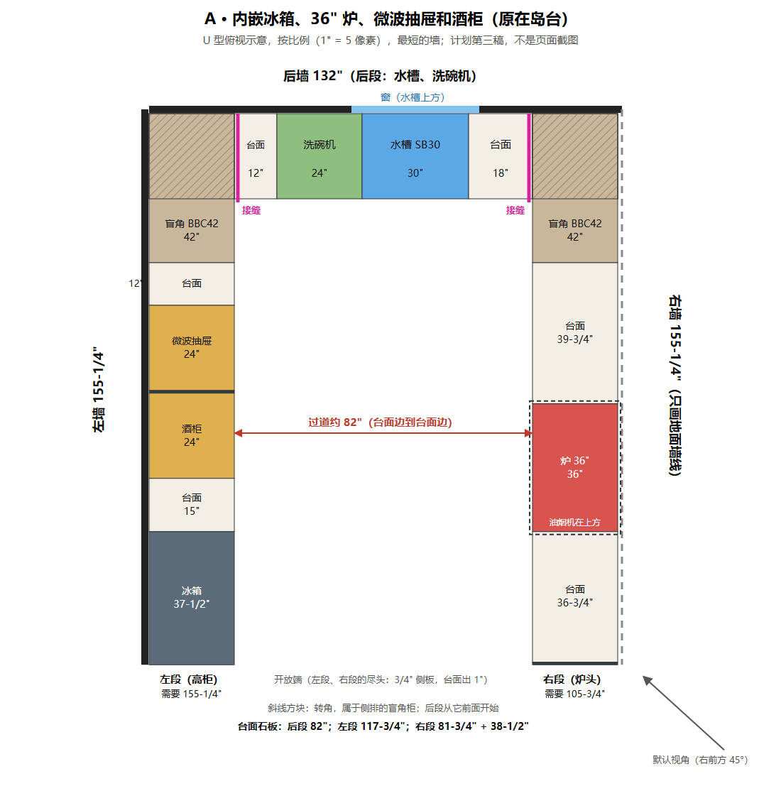
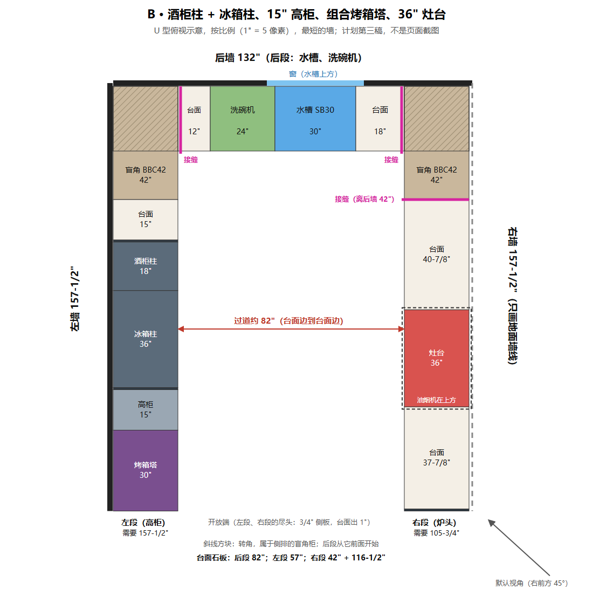
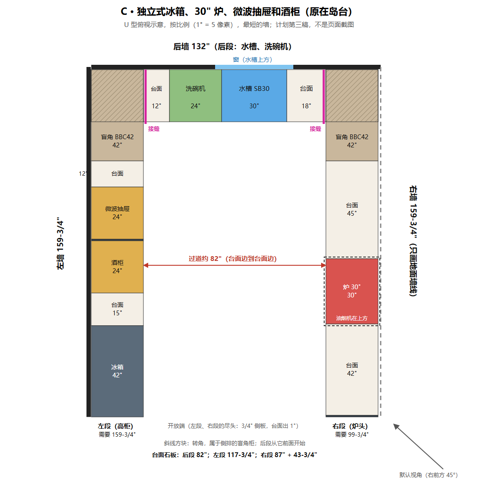
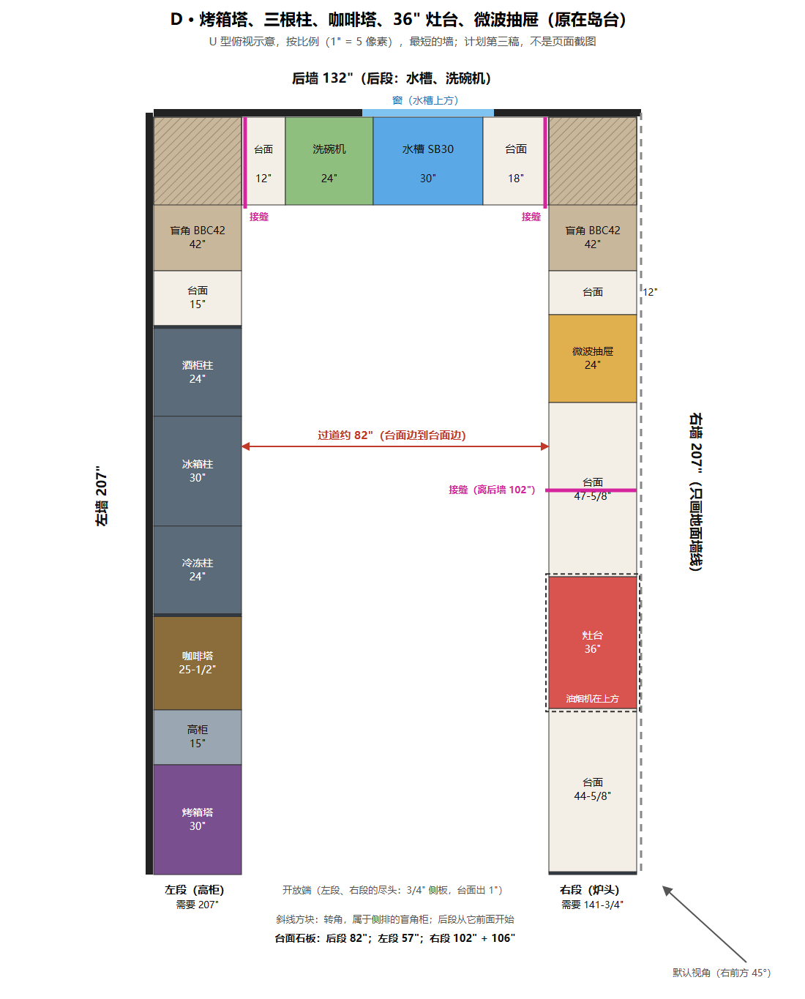
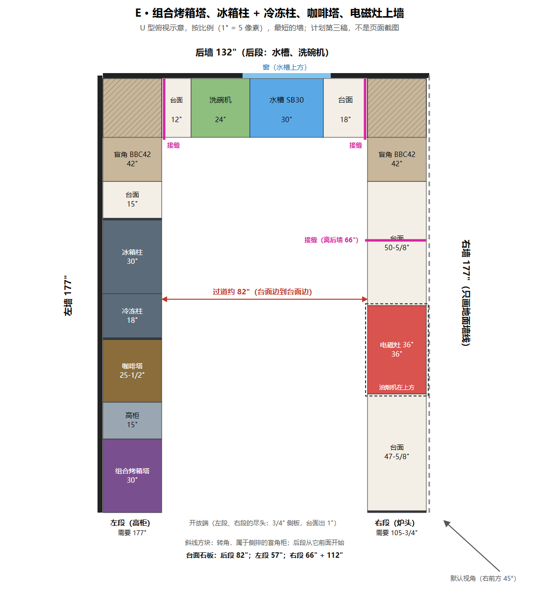

# U 型（计划第三稿，2026-11-10）

**状态：计划，没动代码。** 第二稿 Leo 当天看过；他的原话在 `docs/decisions.md`，"The U: Leo's answers of 2026-11-10, and the galley cancelled"，"Leo's answers to the plan's second draft"。第三稿照他的答复改，确认以后才动手。

尺寸是 `9b06f41` 上生成器自己的清单（`wallRequirement`）按 Leo 定的排法重新排出来的，**不是生成器生成的 U**。图和数字由脚本生成，放在 `docs/plans/u-shape-2026-11-10/`：
- 五张俯视图 `u-A.png` 到 `u-E.png`（附 `.svg`）；
- 接缝近景 `u-seams.png`（第二稿的甲、乙，你选了乙）；
- `figures.json`，每段的宽度和每块石板的长度。

---

## 0. 五分钟摘要

- **左段的新顺序**（你的「15"做成高柜，让烤箱塔靠近开放端」），从转角读起：
  - 盲角 | 台面 15"（冰箱旁）| 柱子 | 咖啡塔 | 15" 高柜 `T1596` | 烤箱塔在开放端。
  - A、C 没有烤箱塔，不变。
- **咖啡塔的位置**是我的建议：放在柱子和 15" 高柜之间。
  - 不挨烤箱塔（TCM24PS 第 9 页）；
  - D 只有这样放才不超过 216"。
- **柱子离发热电器 1-3/16"**：烤箱塔和柱子之间至少隔着 15" 高柜，满足（第 3 节）。
- **墙长**：后墙五个都是 132"；左右墙：
  - A 155-1/4"
  - B 157-1/2"（第二稿 154-1/2"）
  - C 159-3/4"
  - D 207"（第二稿 204"，离 216" 上限 9"）
  - E 177"（第二稿 174"）
- **接缝照乙**：左段、右段各一块石板顶到后墙，后段夹在中间，接缝在后段两头。
- **板长建议 120"**，出处是 Caesarstone 标准板 3050 mm（第 5 节）。
- **超过 120" 的只有 B、D、E 的右段**：
  - 它们的灶台、电磁灶是在石板上开孔，石板不断；
  - A、C 是落地炉，石板本来就在炉两边断开。
  - 各加一道缝，都落在柜子接缝上，避开开孔和微波抽屉：
    - B：离后墙 42"
    - D：离后墙 102"
    - E：离后墙 66"
- **问你的 4 件**（第 7 节）：
  1. 咖啡塔放这里行不行；
  2. 15" 高柜叫什么；
  3. 板长用不用 120"；
  4. 三道中间缝的位置。
- 管线进口已定：右墙、离开放端 4'。E 的 L 咖啡塔挨着组合烤箱塔，已登记进 Open items，这一轮不动。

---

## 1. 已经定了的

**六条**（2026-11-10），第 3、4 条照你后来的话读：
1. 三排（左、右、尽头），挡视线的墙只画地面墙线；
2. 水槽在 U 底部那一排，洗碗机紧挨水槽；
3. 一条侧排放高柜，另一条是操作排，炉头在操作排中段；烤箱塔和灶如果挨着，中间至少 9"。U 里不挨着；
4. 过道 48" 是最小值，实际由后段决定，约 82"；
5. 不配岛台；
6. 转角照 L 型，开放端 3/4" 侧板、台面出 1"，高柜靠墙 3" 整高填充板。

**你对第一稿、第二稿的答复**：
- 左段（高柜）：冰箱、柱子、烤箱塔、咖啡塔都在这一段；
- 右段（炉头）：炉头在中段，两边台面，油烟机在上方；
- 两座塔不分到两段，D22 第 55 轮照旧；
- 洗碗机到转角至少 12" 台面（D11 第 10 条，2026-11-10 修订；L 查过，没有贴转角的）；
- 管线：水、电、煤气、电表箱都在右墙，进口离开放端 4'，和 L 对应；
- 名字：左段、后段、右段；Left leg、Back leg、Right leg；
- 转角 9 条照 L，右边镜像；
- 台面在转角接缝，照乙；
- 其余 43 题照倾向（第二稿 5.2 列了跟着变的）。

---

## 2. 左段的顺序

从转角往开放端（B、D、E；A、C 不变，见第 4 节）：

1. 盲角 `BBC42` 42"
2. 台面 15"：冰箱旁的台面（第 6 条），也是离转角至少 12" 的那一段（第 1 条）
3. 柱子：两侧 3/4" 板，箱体直接贴着（A-3）
4. 咖啡塔（D、E）：连两侧 3/4" 板 25-1/2"
5. **15" 高柜 `T1596`**
6. 烤箱塔 30"，在开放端，它自己的两侧板在 30" 里面（第 92c 轮）

**咖啡塔为什么放这里（建议，要你确认）**：
- 不挨烤箱塔，中间隔着 15" 高柜：TCM24PS 安装说明第 9 页 "Do not mount the appliance directly over or under or on side of a heating appliance."（2026-11-10 从 PDF 第 9 页读的）；
- 挨着冷冻柱，和你看过、同意过的 E 一字型一样。柱子说明书第 9 页那个"发热电器"标志指不指咖啡机，98b 查过，文件没写；
- 门铰在机器左边，在左段上朝开放端，挨着 15" 高柜，两者正面齐平。说明书 13-3/4" 说的是到侧墙那种挡在旁边的东西，这里没有；
- 另外两种放法都不行：
  - 放在转角旁（盲角 | 12" | 咖啡塔 | 15" | 柱子 | 高柜 | 烤箱塔）：D 要 219"，超过 216"；E 要 189"；
  - 放在烤箱塔外面（开放端）：挨着烤箱塔，违反第 9 页。

**这样排，几条规则各自怎样**：
- 第 1 条（高柜在一段的尽头）：柱子、咖啡塔、高柜、烤箱塔连成一排到开放端，台面从转角一直通到它们，不被高柜切断；
- 第 3 条（台面从转角通到高柜，不断）：满足；
- 第 6 条（冰箱旁 15"）：满足；
- 柱子离发热电器 1-3/16"（柱子安装说明第 9 页 "a ≥ 1-3/16" (≥ 30 mm)"）：
  - B：柱子和烤箱塔之间是 15" 高柜；
  - D、E：中间是咖啡塔加 15" 高柜，40-1/2"；
  - 都满足。D11 记着这条"不实现，哪天有人把烤箱放进柱组再说"，U 里烤箱塔不进柱组，所以还是不用实现，只在 U 的检查里写一句"烤箱塔和柱子之间至少隔一个高柜"。

**15" 高柜**：
- **编号 `T1596`**：照现有的规矩 `T` + 宽 + 高（`docs/reference/cabinet-modules.md`，"Reading a code" 的 `T3696` "Tall / pantry, 36" wide × 96" tall"）；高柜宽 9–36"（同一文件，"Tall cabinets"，KraftMaid）；96" 高，上面照 D19 加 12" 顶柜到天花板，和旁边的塔一样；一扇门。
- **叫法：没有现成的。** 现在的"高柜"都是装机器的（`T3096` 是烤箱塔的柜子），没有空的储物高柜。现有的词是 `cabinet.tall`：「高柜」/ "Tall tower"。问你（第 7 节第 2 题）：
  - 中文：「15" 高柜」还是「储物高柜」？
  - 英文："Tall tower" 照用，还是 "Tall cabinet" / "Pantry cabinet"？

---

## 3. 五个套餐的排法（最短的墙）

共同的：
- **后段**（后墙 132"）：让出 24" | 台面 12" | 洗碗机 24" | 水槽 30" | 台面 18" | 让出 24"；窗在水槽上方。
- **右段（炉头）**：盲角 42" | 台面 15" | 炉头 | 台面 12" | 侧板 3/4"。左段比右段长，多出来的对半分在炉头两边，炉头在中段；油烟机在上方。
- 过道约 82"。
- 管线从右墙离开放端 4' 进来。

### A

- 后墙 132"，左右墙 **155-1/4"**（不变）。
- 左段：盲角 42 | 台面 12 | 微波抽屉 24 | 隔板 3/4 | 酒柜 24 | 台面 15 | 冰箱 37-1/2。
- 右段：盲角 42 | 台面 39-3/4 | 落地炉 36 | 台面 36-3/4 | 侧板 3/4。

### B

- 后墙 132"，左右墙 **157-1/2"**（第二稿 154-1/2"，+3"）。
- 左段：盲角 42 | 台面 15 | 酒柜柱 18 + 冰箱柱 36（两侧 3/4" 板）| 15" 高柜 | 烤箱塔 30。
- 右段：盲角 42 | 台面 40-7/8 | 灶台 36 | 台面 37-7/8 | 侧板 3/4。

### C

- 后墙 132"，左右墙 **159-3/4"**（不变）。
- 左段：盲角 42 | 台面 12 | 微波抽屉 24 | 隔板 3/4 | 酒柜 24 | 台面 15 | 独立式冰箱 42。
- 右段：盲角 42 | 台面 45 | 落地炉 30 | 台面 42 | 侧板 3/4。

### D

- 后墙 132"，左右墙 **207"**（第二稿 204"，+3"）。**左段最长**，离 D13 一段的上限 216" 只剩 9"。
- 左段：盲角 42 | 台面 15 | 酒柜柱 24 + 冰箱柱 30 + 冷冻柱 24（两侧 3/4" 板）| 咖啡塔 25-1/2 | 15" 高柜 | 烤箱塔 30。
- 右段：盲角 42 | 台面 12 | 微波抽屉 24 | 台面 47-5/8 | 灶台 36 | 台面 44-5/8 | 侧板 3/4。
- 微波抽屉照第二稿放右段：放左段要 231"，超过 216"。

### E

- 后墙 132"，左右墙 **177"**（第二稿 174"，+3"）。
- 左段：盲角 42 | 台面 15 | 冰箱柱 30 + 冷冻柱 18（两侧 3/4" 板）| 咖啡塔 25-1/2 | 15" 高柜 | 组合烤箱塔 30。
- 右段：盲角 42 | 台面 50-5/8 | 电磁灶 36（`B36` 上）| 台面 47-5/8 | 侧板 3/4。

**五个都放得下，什么都不省。** 比第二稿每个有烤箱塔的套餐长 3"：第二稿是转角旁 12" 加冰箱旁 15"，现在两段并成冰箱旁一段 15"，多了 15" 高柜，净多 15 − 12 = 3"。

---

## 4. 接缝（照乙）

- 左段、右段各一块石板，从后墙做到开放端，开放端台面出 1"；
- 后段一块石板夹在两块中间；
- 接缝在后段两头，离左墙、右墙各 25"（侧段台面的深度：柜 24" + 出 1"），落在后段第一个柜子的边上，两个转角各一道；
- 页面上画法：两块石板对接，接缝处在台面面上和前边各画一条深色细线（图上是粉色粗线）。

---

## 5. 板长和每段的石板

**板长建议 120"**：
- 出处：Caesarstone，"Products Technical Info"（<https://www.caesarstone.ca/about-us/products-technical-info/>，2026-11-10 读）：
  - 标准板 "Width 144 cm"、"Height 305 cm"，约 56-3/4" × 120"；
  - Jumbo "128" (327cm) ±1.5% Length × 64.5" (164cm) ±1.5% Width"，只有部分颜色有。
- 为什么用 120"：标准板所有颜色都有。用 Jumbo 的 128" 也改变不了哪段要加缝（下面三段超过 128" 的还是那三段）。
- **没算加工损耗**：网上没找到厂家写的数。
- 你确认以后，这一页存进 `docs/reference/`，在 README 里写一行（D21）。
- 店里常用的如果不是石英石（比如花岗岩），板长要另找出处。

**每个套餐三段台面的石板**（后段 / 左段 / 右段）：
- **A**：
  - 后段 82"
  - 左段 117-3/4"（离 120" 只差 2-1/4"）
  - 右段 81-3/4" + 38-1/2"（落地炉把石板分成两块）
- **B**：
  - 后段 82"
  - 左段 57"
  - 右段 158-1/2"，超过 → 42" + 116-1/2"
- **C**：
  - 后段 82"
  - 左段 117-3/4"（同 A）
  - 右段 87" + 43-3/4"（落地炉分开）
- **D**：
  - 后段 82"
  - 左段 57"
  - 右段 208"，超过 → 102" + 106"
- **E**：
  - 后段 82"
  - 左段 57"
  - 右段 178"，超过 → 66" + 112"

（左段的石板到第一个落地的高柜为止；右段到开放端外 1"。）

**右段中间那道缝落在哪**：
- 规则：
  - 不穿过开孔；
  - 不在洗碗机、微波抽屉上方（下面没有柜子托着）；
  - 落在两个底柜的接缝上；
  - 两块都不超过 120"。
- **B 离后墙 42"**：盲角柜和下一个底柜的接缝。离灶台开孔 40-7/8"，两块 42" 和 116-1/2"。
- **D 离后墙 102"**：微波抽屉后面那段 47-5/8" 台面里，第一个 24" 底柜的边上。离微波抽屉 24"、离灶台开孔 23-5/8"，两块 102" 和 106"。缝只能在离后墙 88" 到 120" 之间，两块才都不超过 120"。
- **E 离后墙 66"**：转角后第一个 24" 底柜的边上。离电磁灶开孔 26-5/8"，两块 66" 和 112"。缝只能在 58" 到 120" 之间，再除掉开孔。
- 底柜具体怎么分由生成器在 U-1 定，到时让一个柜子接缝正好落在这些位置附近，有出入再报。

---

## 6. 打算怎么做

三轮，和第二稿一样：
1. **U-0 准备**：页面不变；
2. **U-1 数据和生成器**：页面不变，手改链接 `shape=U` 能看到。这几条在这一轮写进生成器和检查：
   - 洗碗机离转角 12"；
   - 烤箱塔和柱子之间至少隔一个高柜；
   - 咖啡塔不挨烤箱塔；
   - 石板按 120" 断开；
3. **U-2 界面**：开关、控件、右墙地面墙线、接缝的细线、名字、提示；右段悬空的吊柜和油烟机，你在预览里看了再定。

每轮：测试先红后绿；真鼠标、真手指；像素证明；全套测试（不跨待机）；预览给你看，你看过才提交。

---

## 7. 问你的（4 件）

1. **咖啡塔的位置**：柱子和 15" 高柜之间（第 2 节，D、E 的图）。行不行？
2. **15" 高柜叫什么**：
   - 编号 `T1596` 照现有规矩；
   - 中文「15" 高柜」还是「储物高柜」；
   - 英文 "Tall tower"（现有的词）还是 "Tall cabinet" / "Pantry cabinet"。
3. **板长**：用 120"（Caesarstone 标准板）？店里常用的是不是石英石？
4. **右段中间的缝**：B 离后墙 42"、D 102"、E 66"，行不行？
